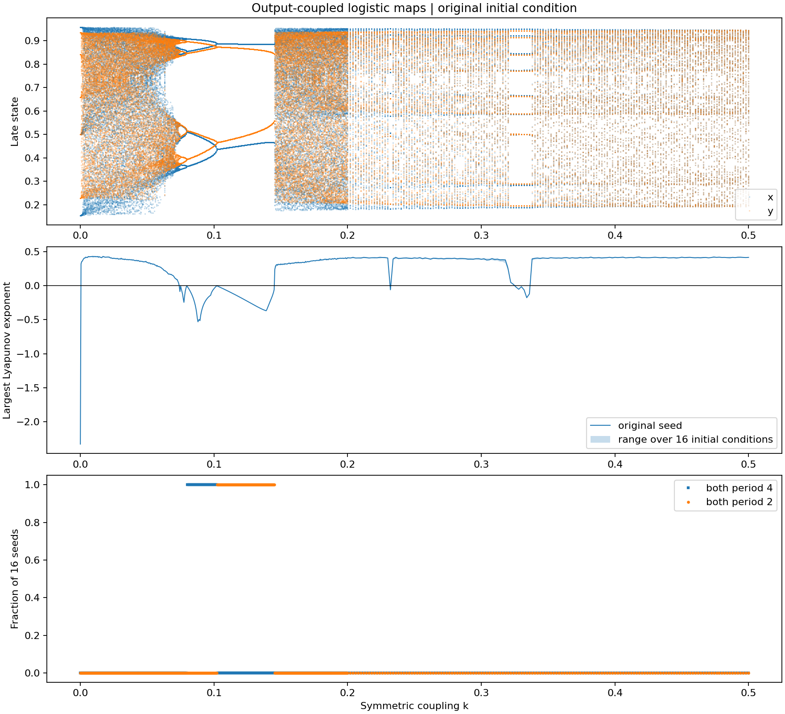
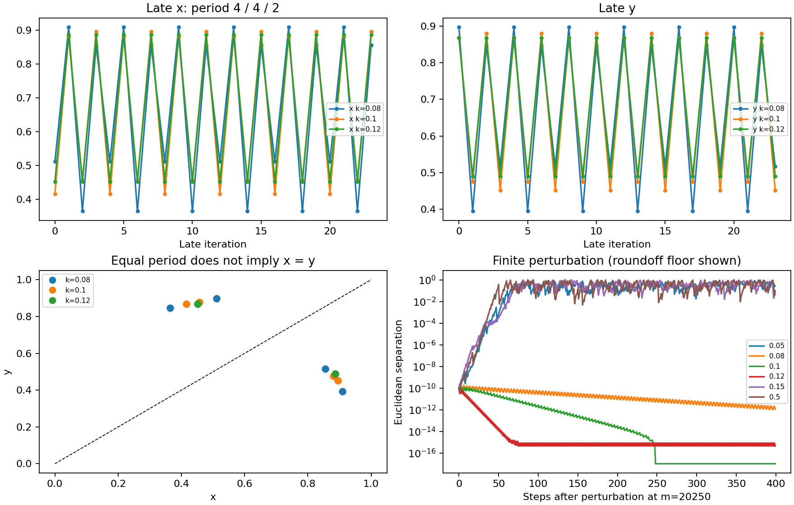

# 耦合之後，週期如何改變？

探索型非線性動力學實驗 · 2026-10-18
重現了原本週期 3、5 的兩個映射在耦合後形成共同週期 4，並找到週期 16、8、2、15 等區域。耦合強度增加時，規則化、混沌與完全同步並非同一件事。所有數值結論都限於本次參數、取樣與運算精度；原始模型與根目錄檔案維持原樣；本實驗獨立存放於此資料夾。


## 1. 從既有模型出發


來源：[HTW 的 log2inter.py](https://github.com/tim32142000/two-interacting-logistic-map-systems/blob/3366589902cf4a312f73dd8d7a0a1df2643149c0/log2inter.py)。固定 rₓ=3.8318741、rᵧ=3.7389149，預設 (x₀,y₀)=(0.12924,0.2304)。以狀態 x[0],y[0] 為第 0 步，第 m=250 次更新起施加對稱耦合。


```text
a = rₓ xₙ(1−xₙ),   b = rᵧ yₙ(1−yₙ)
xₙ₊₁ = a + k(b−a)
yₙ₊₁ = b + k(a−b)
```


實驗保持原始運算順序。k=0.1 的前 400 步，與直接執行原程式計算部分逐點、逐位元相同。


## 2. 指標與實驗規格

| 問題 | 指標與限制 |
| --- | --- |
| 有沒有週期？ | 搜尋最小 p=1…64，使最後 1,024 點的全部重複差 \|zₙ₊ₚ−zₙ\| 小於 10⁻⁸。x、y 分開判斷；未找到時標為未辨認。代表案例另以 10⁻⁶、10⁻¹⁰ 複查。 |
| 兩個狀態是否相同？ | 長時間平均與最大 \|xₙ−yₙ\|。共同週期不能取代這項檢查；接近零也不能僅憑容差證明精確相等。 |
| 微小誤差會成長嗎？ | 使用解析二維 Jacobian 與反覆正規化的切向量計算最大 Lyapunov 指數；自然對數、單位為每次映射。正值支持敏感依賴，負值支持沿軌道的微擾衰減。1,024 步分塊的最小／最大值是收斂診斷，不是信賴區間。 |
| 有限擾動的後果？ | 在第 20,250 步的已沉降軌道，將 x 增加 10⁻¹⁰，觀察兩條二維軌道的距離。避免在第 250 步接近 x=y=0.5 的臨界點施擾，因雙精度可能立即抹掉微擾。 |
| 循環是否局部穩定？ | 求 Fᵖ(z)=z 的數值根，計算一整個週期 Jacobian 乘積的特徵值（Floquet multipliers）；模長皆小於 1 是局部吸引的數值依據。此處未用區間算術作嚴格證明。 |


主掃描：0≤k≤0.2、間距 0.0005；0.202≤k≤0.5、間距 0.002，共 551 個強度。每個強度使用預設值加 15 組固定亂數初始條件（亂數種子 20261018）。每條軌道先走原本 249 步無耦合更新，再丟棄 12,000 步耦合暫態，測量 8,192 步。


8 個代表強度以同樣 16 組初始值延長為丟棄 50,000 步、測量 65,536 步。另以 3×5 個無耦合週期相位組合，加原始初始值，檢查近零耦合與主要邊界（20,000 步暫態、16,384 步測量）。


## 3. 重現與代表結果


下表採原始初始值的長時間結果。「未辨認」表示週期未在 p≤64 的規則下檢出；混沌判斷另依持續為正的 Lyapunov 指數與擾動成長。

| k | x / y 週期 | 最大 Lyapunov 指數 | 平均 \|x−y\| | 數值解讀 |
| --- | --- | --- | --- | --- |
| 0 | 3 / 5 | -2.32918 | 0.34829 | 穩定週期 |
| 0.05 | 未辨認 / 未辨認 | +0.34257 | 0.31411 | 混沌的數值證據 |
| 0.08 | 4 / 4 | -0.01103 | 0.43035 | 穩定週期 |
| 0.1 | 4 / 4 | -0.04308 | 0.43121 | 穩定週期 |
| 0.12 | 2 / 2 | -0.17540 | 0.40679 | 穩定週期 |
| 0.15 | 未辨認 / 未辨認 | +0.31791 | 0.09034 | 混沌的數值證據 |
| 0.3 | 未辨認 / 未辨認 | +0.38875 | 0.00610 | 混沌的數值證據 |
| 0.5 | 未辨認 / 未辨認 | +0.41497 | 0.00000 | 混沌的數值證據 |


k=0.05 的 16 組初始條件之最大指數為 0.34196～0.34452；k=0.15 為 0.31154～0.31881。兩者原始初始值的所有 1,024 步測量區塊皆為正。這比「曲線看起來雜亂」更能支持混沌，但仍不是數學上的混沌證明。


**原程式 400 步尚不足以確認漸近週期。**例如 k=0.1，在最後 22 點與相隔 4 步資料之間，最大誤差仍約 9.35×10⁻⁶；k=0.08 約 3.29×10⁻³。若用完整最後 100 點與 10⁻⁸ 容差，k=0.08、0.10、0.12 都尚未檢出週期。延長後才分別確認為 4、4、2。因此原圖的觀察方向正確，但圖像本身不完成穩定性確認。


## 4. 掃描中出現的規律





上圖：晚期 x、y 值；中圖：最大 Lyapunov 指數，淡色表示 16 組初始條件的範圍；下圖：取樣初始條件中兩者皆為週期 4、2 的比例。僅每個 k 的預設初始值用於上圖，並不展示全部吸引域。

| 取樣到的 k 範圍 | 兩者共同週期 | 解讀 |
| --- | --- | --- |
| 0.074～0.0745 | 16 | 每一個主掃描網格點，16 組初始條件的週期標籤均一致。這些是取樣範圍，不是精確分岔邊界。 |
| 0.075～0.0795 | 8 | 同上。 |
| 0.080～0.1020 | 4 | 同上。 |
| 0.1025～0.1450 | 2 | 同上。 |
| 0.232（單一網格點）、0.330～0.336 | 9 | 較大耦合區另有週期窗；需局部細掃。 |
| 0.326～0.328 | 18 | 與附近週期 9 窗的關係待追蹤。 |


代表案例 k=0.08、0.10、0.12 的 16 組初始值，得到相同循環點集（忽略循環起點，最大軌道距離約 10⁻¹⁴ 或更小）。因此這裡不只是相同週期標籤。不過，這仍不排除未抽到的其他吸引域。


**近零耦合有容易漏掉的細節：**在 k=10⁻⁷、10⁻⁶、10⁻⁵、10⁻⁴、0.0002、0.0003，兩個投影都出現共同週期 15，最大指數為負。到 k=0.0004，所測初始值均為正指數、未辨認簡單週期。原本無耦合的二維組合軌道就有最小公倍數 lcm(3,5)=15；因此「兩者出現同一週期」本身，未必代表新的同步機制。這也說明主掃描 0.0005 的間距會漏掉狹窄區域。


## 5. 可以支持到什麼程度？


**直接數值觀察：**上述週期窗、週期標籤對初始值的穩健性、狀態差距與正／負 Lyapunov 指數。k=0.1 的四個循環點約為 (0.456755,0.879652)、(0.895304,0.451317)、(0.415848,0.869198)、(0.880258,0.475661)。兩者同週期但常在相反高低位置，平均差距約 0.431；可稱共同週期／週期鎖定，不能稱完全狀態同步，也尚未另定義相位來宣稱特定相位同步。


**局部穩定性數值支持：**k=0.08 的週期 4 軌道乘子約 −0.95683、−0.29451；k=0.10 約 0.84170、0.47687；k=0.12 的週期 2 約 −0.70412、−0.19228。模長皆小於 1，且最大模長的 log 除以週期，與切向量法最大指數一致。k=0.08 的收斂尤其慢，因最大模長接近 1。


**可能機制：**共同週期 16→8→4→2 的次序，符合反向倍週期序列。延續週期 2 軌道的數值根時，發現一個乘子在 k=0.10205～0.10210 之間穿越 −1，支持此處的 4→2 轉換。其餘邊界尚未逐條做軌道延續，不能僅依序列就宣布完整分岔結構已證明。


**仍屬猜想：**所有初始條件都收斂到同一吸引子、整段參數區間不存在狹窄其他窗口、改變 rₓ/rᵧ 後仍保有相同序列、或任何「週期 3 和 5 必然形成週期 4」的普遍法則。本次沒有證明這些主張。


## 6. 由方程式直接推出的同步限制


```text
xₙ₊₁ − yₙ₊₁ = (1−2k)[rₓxₙ(1−xₙ) − rᵧyₙ(1−yₙ)]
```


因此耦合使「本次兩個映射輸出之差」乘上 (1−2k)，但括號內的量也隨狀態改變，不能據此推出長時間差距隨 k 單調下降。本次平均差在 k=0.05、0.08、0.10 分別約 0.314、0.430、0.431，就是反例。


若某一步 x=y=z，則下一步差距為 (1−2k)(rₓ−rᵧ)z(1−z)。因 rₓ≠rᵧ，在 k≠0.5 時，一般內部狀態不會保持相等；在 [0,1] 中持續完全同步的例外只有落向零的平凡軌道。


但 **k=0.5 時，每次更新的兩個輸出按公式就必然相等**。首次耦合後進入同步對角線，之後共同值滿足：


```text
zₙ₊₁ = [(rₓ+rᵧ)/2] zₙ(1−zₙ)
       = 3.7853945 zₙ(1−zₙ)
```


這個降維關係由代數直接成立，與圖形無關。本次這條共同軌道最大指數約 +0.415；兩個系統彼此完全同步，但兩條微小不同初始狀態的同步軌道仍會彼此分離。完全同步與混沌可以同時存在。相反地，k=0.1 的共同週期 4 很穩定，卻完全沒有 x=y。





擾動圖的曲線降到機器精度後，數值相等與四捨五入會主導；圖中最低值設為 10⁻¹⁷ 以便對數座標顯示，不表示實際仍存在該大小的非零距離。


## 7. 下一輪最有價值的實驗


- **改變原始週期對。**固定掃描流程，改用附近其他週期 3／5 參數，或週期 3／4、4／5，研究共同週期 4 是特定參數窗口，還是更一般的耦合分岔現象。這最接近「不同系統為何產生共同現象」的問題。

- **追完整分岔分支。**延續週期 4、8、16 與 2 軌道，對各邊界計算乘子，追蹤 k≈0.145 的穩定軌道如何消失。需要時用高精度或區間算術驗證。

- **找多重穩態與吸引域。**在邊界及週期窗口附近，從「耦合啟動瞬間的二維狀態」直接做密網格取樣，並比較逐步升／降 k 的延續掃描。現在所有初始值都有 249 步無耦合預處理，不能代表整個二維吸引域。


建議下一步先做第 1 項，採少量 rₓ/rᵧ 組合，回答：「週期 4 是由 3 和 5 決定，還是由耦合系統當下的分岔結構決定？」目前證據較支持後者，但需要跨參數實驗。


## 重現與資料

執行方式見 README.txt。所有 CSV、圖、尾端軌道、環境版本與數值檢查位於 results/。程式 run_experiment.py 與 refine.py 彼此獨立於來源快照；本次新增僅限本實驗資料夾。來源快照與上游授權位於 source/。本報告為有限時間、雙精度數值實驗；未找到多重穩態或準週期狀態，不代表它們不存在。未作一般性嚴格穩定性或混沌證明。
