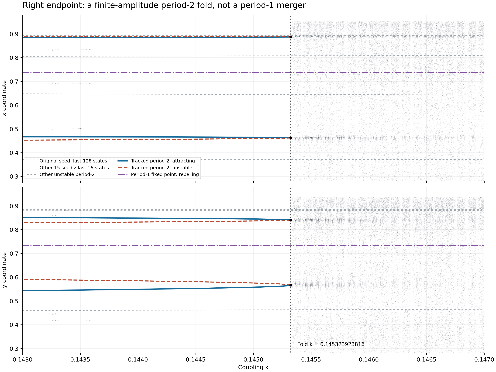
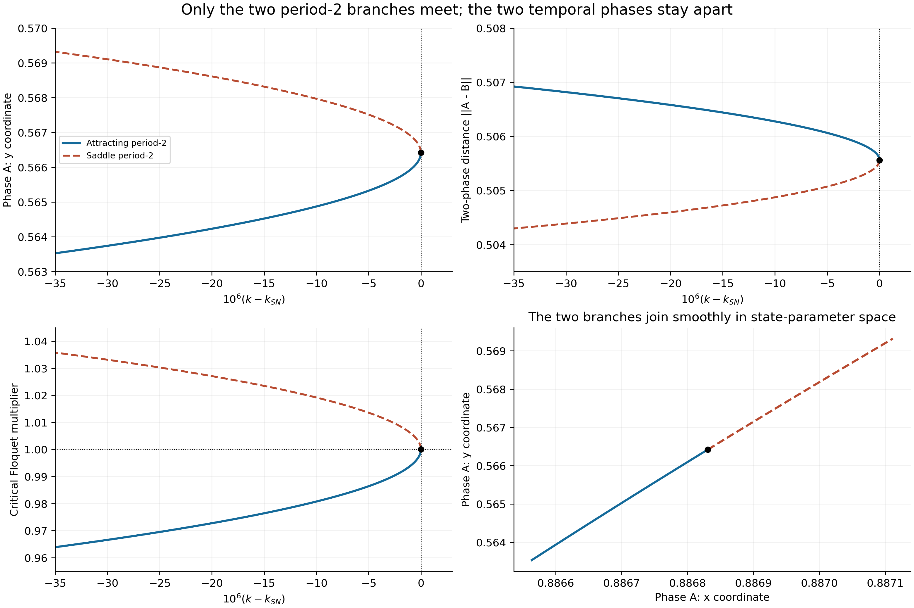
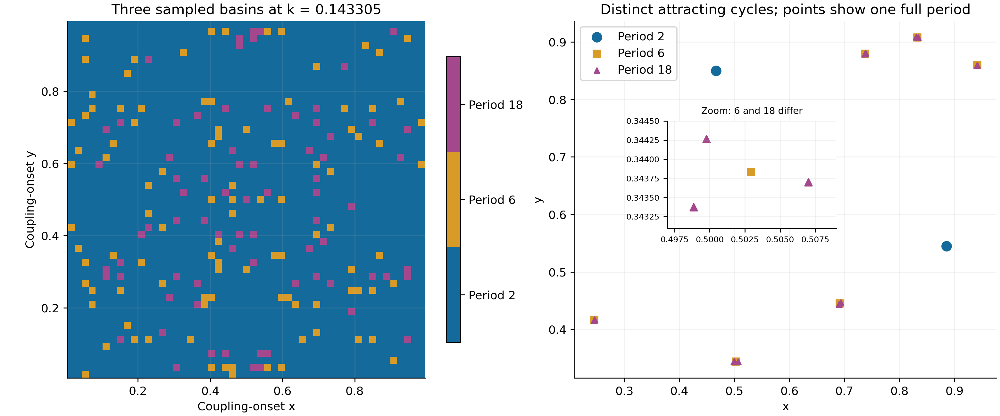

# 二週期分岔區域的右端追蹤

固定 `rₓ=3.8318741`、`rᵧ=3.7389149`，研究 `k≈0.145` 附近的 period-2 是否連續接上 period-1。

**結果：此二週期分支在 `k≈0.1453239238155238` 與鞍型二週期分支相遇並折返，沒有收縮成固定點。** 折返時兩個時間相位仍相距約 `0.50556059`，二步 Floquet 乘子約為 `+1`、`−0.54780318`。

## 圖文報告

- **[完整研究報告：直接在 GitHub 閱讀](REPORT.md)**，含六張圖、數學推導、數值驗證及限制。
- [離線 HTML 報告](right_endpoint_report.html)：下載後以瀏覽器開啟，六張圖片已內嵌。
- [穩定／不穩定二週期分支與固定點數據](results/period2_branch.csv)。
- [80 位精度分岔點與局部正常形係數](results/precision.json)。





## 額外發現

在 `k=0.143305`，確認 period-2、6、18 的吸引軌道共存。這是初值造成吸引子選擇的案例，與右端週期軌道折返不同。折返右側另觀察到長時間近二週期暫態，其停留時間符合 saddle-node ghost 的反平方根尺度。



## 重現

使用 Python，在本資料夾依序執行：

```bash
python -m pip install -r requirements.txt
python run_all.py
```

程式只覆寫本資料夾的 `results/` 與 HTML，不需要 GitHub 權杖。完整流程包含密集初值掃描；套件安裝需網路，計算本身不需要外部服務。

若要直接使用已發布的原始掃描數據，先執行 `python assemble_data.py`，即可從 `results/scan.npz.parts/` 還原 `results/scan.npz`，程式會逐片及整檔核對 SHA-256。分片沒有改變數據精度或內容；完整重跑 `run_all.py` 也會直接產生此檔。

| 位置 | 內容 |
|---|---|
| `REPORT.md`、`right_endpoint_report.html` | 完整圖文報告 |
| `research.py`、`precision.py`、`algebra_check.py`、`analyze.py` | 偽弧長延續、乘子、高精度複算、代數枚舉及驗證 |
| `simulate.py`、`coexistence.py` | 多初值、長時間、吸引域與共存檢查 |
| `plots.py`、`make_report.py`、`run_all.py` | 圖表、HTML 與完整執行入口 |
| `results/` | 六張高解析度圖、CSV、JSON、NPY／NPZ 原始數據 |
| `source/` | 原始實驗來源快照、Git blob SHA 與授權 |
| `SHA256.json` | 本資料夾檔案的 SHA-256 校驗值 |

本研究提供高精度數值證據，未使用區間算術作嚴格分岔存在性證明；有限初值取樣與正 Lyapunov 估計也不構成吸引子唯一性或混沌的定理。研究日期為 2026-10-25。
