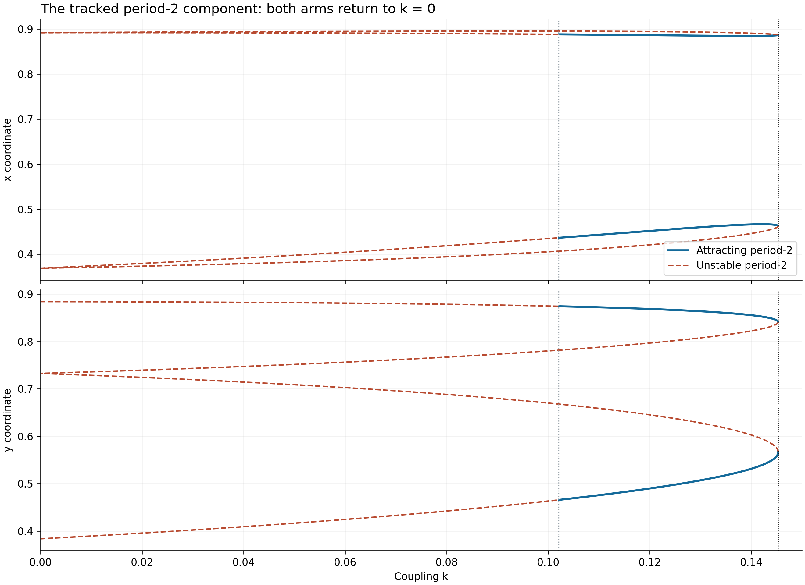
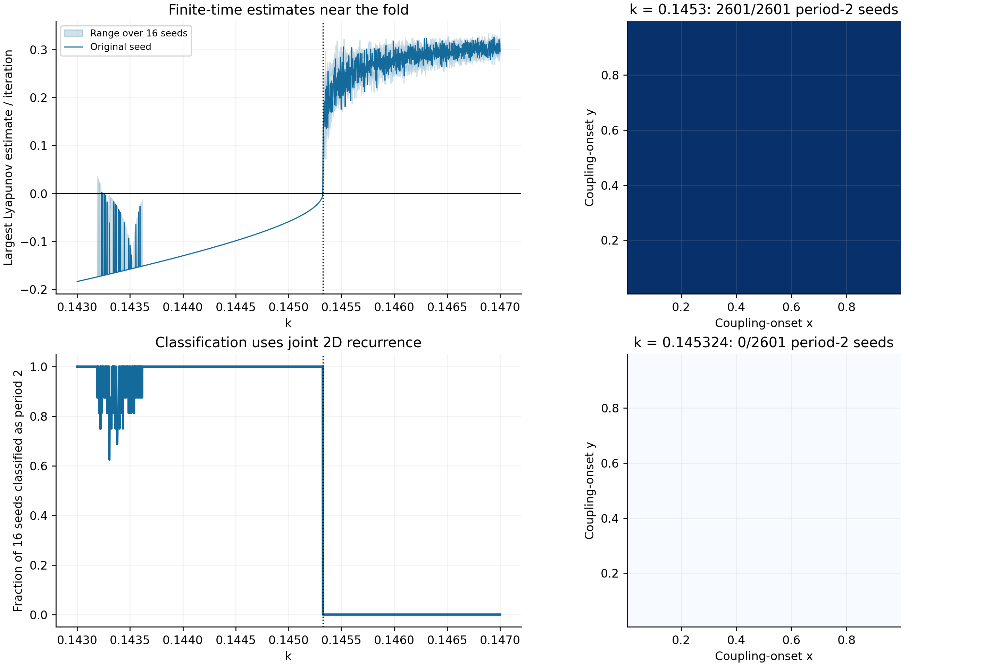
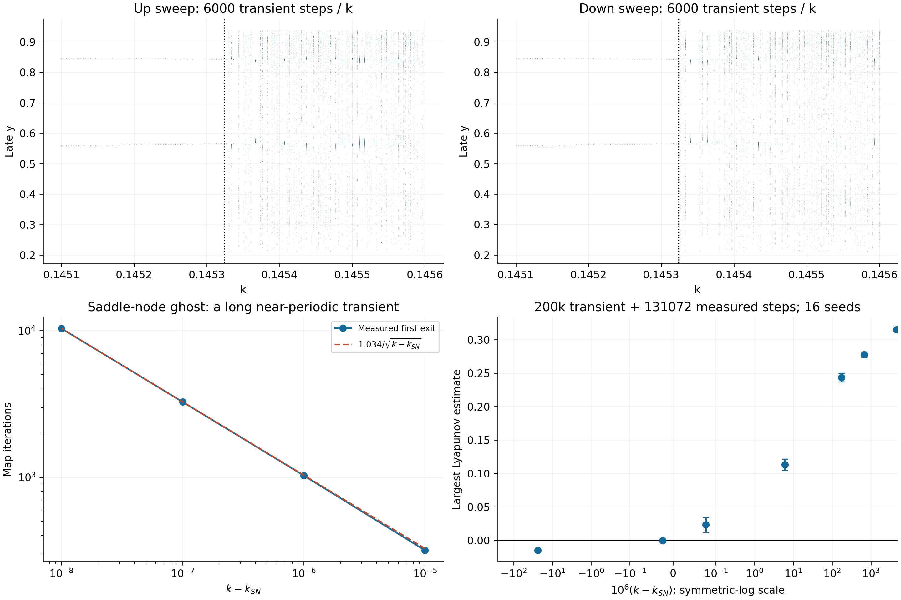

# 二週期區域右端：連到固定點，還是週期軌道折返？

兩個輸出耦合 Logistic maps · 獨立數值研究 · 2026-10-25

## 1. 研究結論

**這一段 period-2 在右端沒有連續合併成 period-1。它在 k ≈ 0.1453239238155238，與另一條鞍型 period-2 分支相遇並折返。** 在折返點，兩個時間相位 A、B 仍相距約 0.50556059；相遇的是兩條不同二週期軌道的對應相位，不是同一軌道的兩個時間相位彼此合併。

這是有限振幅的二週期 saddle-node（fold）分岔的強數值證據。乘子 +1、另一乘子在單位圓內、非零的參數與二次項係數、偽弧長延續的折返形狀，以及獨立的代數根枚舉都互相符合。以下數字由本次實際運算產生；80 位精度複算仍不是區間算術的嚴格存在性證明。


**讀圖：**上、下圖分別是 x、y。藍色實線為追蹤中的吸引二週期；紅色虛線是同一連通分支折回來的鞍型二週期。黑點標示折返的兩個相位。紫色點劃線為排斥固定點；灰色虛線為另外兩條不穩定二週期軌道的座標。灰黑散點來自前向迭代，不與相鄰 k 的散點連線。原點固定點位於此圖縱軸範圍之外。

## 2. 原始程式與初步數值核對

讀取指定實驗的 run_experiment.py、refine.py、REPORT.md，以及 source/log2inter.py。來源檔案的 Git blob SHA 與網址保存在 source/provenance.json；本研究初次計算時未修改 GitHub Repository；本資料夾其後依使用者授權新增至 experiments，未變更既有實驗。

原始映射為：

```text
a = rₓ x(1−x),     b = rᵧ y(1−y)
Fₖ(x,y) = (a + k(b−a), b + k(a−b))
rₓ = 3.8318741,    rᵧ = 3.7389149
```

核對結果：原實驗確實使用預設初值 (0.12924, 0.2304)，加 15 組 rng=20261018 的亂數初值；每組先走 249 步無耦合前史，再丟棄 12,000 步耦合暫態並測量 8,192 步。overview.png 上方僅畫原始初值最後 128 點；refine.py 只將二週期根從 k=0.12 向左延續到約 0.10，沒有穿越右端。

本研究獨立實作 F，重算 k=0.1 的原始 400 步軌跡，與來源程式逐位元一致。解析 Jacobian 對中心差分的最大誤差約 9.76×10⁻¹¹；F²−I 的完整狀態／參數導數差約 2.64×10⁻¹⁰。

| k | 二週期兩相位距離 | 二步 Floquet multipliers | 核對 |
|---|---:|---|---|
| 0.145 | 0.510005881667 | −0.507434981662、+0.888803016710 | 重現先前約 0.510、+0.889 |
| 0.1452 | 0.508201471488 | −0.521216616732、+0.931668962946 | 重現先前約 +0.932 |

## 3. 右端的穩定與不穩定分支

令 G(z,k)=Fₖ²(z)−z。只迭代 F 看不到鞍型軌道；只以 k 為延續參數，在折返處也容易停止或跳到別的根。因此本研究對未知量 (x,y,k) 做偽弧長延續：以 G=0 的零空間取得切向量，沿切向量預測，再以「G=0 加上法向截面條件」作 Newton 修正。

從 k=0.1452 的吸引二週期出發，以弧長步幅 0.0002 穿越右端；局部圖另用 0.00001，並以 0.0001 重跑作步幅複查。主要連通分支有 2,398 個點，最大二步殘差約 1.00×10⁻¹⁵。兩種步幅的折返點精化結果在雙精度顯示值相同。


**局部圖橫軸是 10⁶(k−k_SN)：−10 代表比折返點小 0.000010。**左上顯示相遇的吸引／鞍型軌道之 A 相位；右上顯示兩條軌道各自的時間相位距離。它們都趨近約 0.50556，沒有趨近 0。左下是到達 +1 的二步乘子。右下投影到 A 的狀態平面，顯示根曲線可以平滑通過折返；不能把這種連續性解讀為接上固定點。

| k | 吸引二週期的 μ₊ | 鞍型二週期的 μ₊ | 吸引軌道的 ‖A−B‖ |
|---|---:|---:|---:|
| 0.1450000 | 0.888803017 | 1.107813368 | 0.510005882 |
| 0.1452000 | 0.931668963 | 1.067039703 | 0.508201471 |
| 0.1453000 | 0.970146218 | 1.029604791 | 0.506678107 |
| 0.1453239 | 0.999061960 | 1.000937792 | 0.505594839 |
| k_SN | 1 | 1 | 0.505560594 |

這裡 μ₊ 指接近 +1 的實乘子，不是把所有乘子取模之後的標籤。鞍型分支的另一乘子仍在單位圓內。

## 4. 精化分岔點與非退化檢查

以增廣方程 G=0、det(D F²−I)=0 精化，再將參數十進位值視為精確輸入，用 mpmath 的 80 位算術獨立求解：

```text
k_SN = 0.14532392381552381316297952413630288985…
A    = (0.886830444521846421, 0.566418560154761053)
B    = (0.462128826081403556, 0.840681298112614351)
‖A−B‖ = 0.505560593933179905
eig[D F²(A)] = { +1, −0.547803184303777435 }
```

80 位增廣方程殘差約 2.69×10⁻⁷⁹。這表示計算內部一致，不表示原始模型參數具有 80 位實驗準確度。

取 M=D F²(A)，Mv=v、wᵀM=wᵀ，並規範 ‖v‖=1、wᵀv=1；v 選擇 y 分量為正。對 G 的局部投影：

```text
0 = α(k−k_SN) + βs² + higher-order terms
α = wᵀ G_k                      ≈ 1.49416387439
β = ½ wᵀ D²G[v,v]               ≈ 6.18029735564
k−k_SN = −4.13629151499 s² + higher-order terms
```

α、β 非零，另一乘子不是 ±1，且兩條根分支存在於 k<k_SN 一側，符合一般 saddle-node 的非退化結構。此處的係數由解析一階與二階導數以雙精度計算；向量規範及數值保存在 precision.json。

## 5. 固定點與「二週期連到一週期」的必要條件

如果一條二週期軌道 A(k)、B(k) 連續收縮到固定點 P，則 F(A)−F(B)=−(A−B)。將差向量正規化並取極限，就得到：

```text
D F(P) v = −v，v ≠ 0。
```

因此，在平滑映射的一般二週期／固定點合併處，**固定點必須具有 −1 的一步特徵值**。這個必要條件與固定點最後是否吸引是兩件事。二週期的二步乘子則趨近 (−1)²=+1；反過來，二步乘子 +1 並不足以保證固定點合併。

本次在 k∈[0.14,0.15] 的 2,001 個參數點，使用固定點的四次消去多項式枚舉全部實根。在物理正方形 [0,1]² 中，每個取樣點都有兩個固定點：原點與一個內部固定點；另外兩個實根在正方形外。兩個物理固定點均不穩定。

| k | 內部固定點 P | 一步 Jacobian 特徵值 |
|---|---|---|
| 0.145 | (0.738622800862, 0.732964394999) | −1.787969445927、−1.265075802321 |
| k_SN | (0.738621679338, 0.732965551970) | −1.787960483752、−1.263928141415 |

在折返點，原點特徵值約 +3.78679、+2.68379，也不是 −1。內部固定點的兩個特徵值均小於 −1，是排斥固定點；其作為 F² 固定點的乘子約為 3.1968、1.5975，並非此二週期的 {1,−0.5478}。

因此有兩條互相獨立的排除依據：二週期相位距離不歸零；相鄰固定點也沒有 −1 的特徵值。**可以一般性地發生反向 2→1，但本模型這一段右端沒有這樣發生。**

## 6. 是否漏掉其他二週期分支？

只使用多組 Newton 初猜仍可能漏根。本研究另推導一個六次多項式，對每個固定 k 枚舉全部實二週期。

寫 F(z)=L(z−z²)，其中 L 的四個元素依序記為 a,b,c,e，D=ae−bc。令 A=m+d、B=m−d；上下平方均指逐座標平方。由二週期方程相加、相減：

```text
m = L(m−m²−d²)
L diag(1−2m) d = −d
t = d_y/d_x
m_x = [1+(e−bt)/D]/2
m_y = [1+(a−c/t)/D]/2
S_x = m_x−m_x²−(e m_x−b m_y)/D = d_x²
S_y = m_y−m_y²−(−c m_x+a m_y)/D = d_y²
t²(t² S_x−S_y) = 0
```

最後一式展開是 t 的六次多項式。對 0<k<0.5，非平凡二週期不可能有 d_x=0 或 d_y=0：假設其中一個為零，差方程會迫使另一個也為零。因此此斜率表示不漏掉任何實二週期；t=0 不作有效解。保留實根且 S_x>0，再檢查 F(A)=B、F(B)=A 與物理範圍；d 的正負僅交換時間相位，不是兩條不同軌道。

使用 2,001 點浮點根枚舉，另在 9 個關鍵參數以精確有理係數多項式作實根區間隔離（區間寬度小於 10⁻³⁵）。這是對**指定有理參數點**的獨立根數複查，不是整個參數連續區間的分岔完備性證明。

| 參數例子 | 實二週期軌道總數 | [0,1]² 中的二週期數 | 其中吸引者 |
|---|---:|---:|---:|
| 0.145、0.1452、0.1453、0.1453239 | 6 | 4 | 1 |
| 0.145324、0.14533、0.146、0.15 | 4 | 2 | 0 |

所以「右端二週期消失」特指那一對吸引／鞍型軌道；**不是全部二週期解從方程式消失**。另外兩條物理二週期仍存在，但不吸引一般初值。



本次追蹤的同一連通分支，沿折返兩臂都回到 k=0，沒有在 0≤k≤0.5 的這次追蹤中接上固定點。兩個 k=0 端點的相位距離分別約 0.72403945 與 0.52320920；第二個端點是 x 的二週期搭配 y 的固定點，**整個二維狀態仍是二週期**。較左側另精化到 k≈0.102076970706882 的二週期乘子 −1 交越，這才是與 4↔2 有關的 flip 機制。

## 7. 初值、吸引子切換與真正的多重穩態

右端細掃：k=0.143…0.147 共 2,401 點，保留原來 16 組初值及 249 步前史，耦合暫態 30,000 步，測量 4,096 步，保存最後 128 點。最大指數以解析 Jacobian 的切向量法計算，量測前另有 4,096 步方向對齊。

直接吸引域檢查：從耦合啟動狀態的 51×51 網格出發，座標 0.005…0.995，不走無耦合前史；8 個指定 k 各丟棄 100,000 步、測量 16,384 步。網格是有限取樣，不涵蓋所有邊界點，也不能證明吸引子唯一。



在 k=0.145、0.1453、0.1453239，2,601 個網格初值均檢出二週期；在 k=0.145324、0.14533、0.1455、0.146、0.15，均未檢出最小週期≤64，且本次測量最大指數為正。這支持折返後的非週期、混沌樣長時間行為；不構成混沌的嚴格證明。

**另有一個與折返不同的初值效應，不能略過。**在約 k=0.1431917…0.143615 的部分細掃點，16 組初值並非全落在二週期。本研究因此在五個參數各延長到 500,000 步暫態＋131,072 步量測，再對已收斂軌道求根並檢查最小週期及完整 Floquet 乘子。

在同一 k=0.143305，確認至少三種吸引週期共存：

| 最小週期 | 原來 16 組初值的落入數 | 週期乘子 | 譜半徑 |
|---|---:|---|---:|
| 2 | 10 | −0.473473728、+0.714299991 | 0.714299991 |
| 6 | 2 | −0.545361500 ± 0.799730587 i | 0.967981496 |
| 18 | 4 | +0.200019916 ± 0.155483527 i | 0.253343825 |

求根殘差≤約 1.12×10⁻¹⁵，且排除了所有較短整除週期。這些週期差異不是短暫態誤判。


在 k=0.143305，直接啟動的 2,601 個網格初值，經 200,000 步暫態與 32,768 步測量後，分別有 2,424 個落在二週期、102 個在六週期、75 個在十八週期。這張吸引域圖的格子是取樣結果；顏色比例不是自然界或所有初值的機率。

這個共存區距右端折返還有約 0.002，不能用它來解釋 k_SN 處的根分支消失；但它確實證明「改初值造成圖形不同」與「原分支發生分岔」必須分開診斷。升降 k 掃描也只顯示所選起點及步幅能到達的軌道，不能取代根延續。

## 8. 折返後的近二週期暫態



在折返剛右側，軌跡可能在原二週期位置附近停留很久，再離開。以折返的 A 為初值，記錄首次離開 A 或 B 半徑 0.02 鄰域的步數：

| k−k_SN | 首次離開步數 | 步數 × √(k−k_SN) |
|---|---:|---:|
| 10⁻⁵ | 318 | 1.00560 |
| 10⁻⁶ | 1,028 | 1.02800 |
| 10⁻⁷ | 3,266 | 1.03280 |
| 10⁻⁸ | 10,338 | 1.03380 |

這與局部二步正常形 ds/dn≈αδ+βs² 的 bottleneck／ghost 預期一致。從中心到出口的一側停留時間換成單步映射約 π/√(αβδ)，此處常數約 1.034。這只檢查首次離開，不宣稱每次混沌回訪的停留時間都相同。

另以原 16 組初值作 200,000 步暫態＋131,072 步量測：

| k | 聯合週期 | 最大 Lyapunov 指數：16 初值範圍 |
|---|---|---|
| 0.1453239 | 2 | 約 −0.000469240 |
| 0.145324 | 未檢出≤64 | +0.01207…+0.03424 |
| 0.14533 | 未檢出≤64 | +0.10477…+0.12164 |
| 0.1455 | 未檢出≤64 | +0.23670…+0.25006 |
| 0.146 | 未檢出≤64 | +0.27361…+0.28193 |

緊貼折返的 0.145324，有些 1,024 步區塊的指數仍為負；整段平均為正。這正是不能把局部近週期停留或有限時間指數當成穩定二週期存在性證明的原因。分塊範圍是收斂診斷，不是統計信賴區間。

## 9. 四種機制如何區分

| 機制 | 根分支與乘子診斷 | 本次結果 |
|---|---|---|
| 反向週期倍化 2→1 | A、B 合併；固定點一步特徵值到 −1；二週期二步乘子到 +1 | 右端不符合：相位距離有限，固定點無 −1 |
| 二週期軌道折返 | 兩條不同二週期軌道合併；二步乘子 +1；局部參數曲線折回 | 右端符合，非退化條件亦通過 |
| 吸引子突然消失 | 是觀察到的長時間行為改變，尚需診斷根消失或全域危機 | 此處有局部 fold 證據，無需假設 boundary crisis；未研究所有全域不變集合 |
| 初值造成吸引子切換 | 同一 k 存在多個穩定循環，改初值改變落入結果，原分支仍存在 | k=0.143305 的 2、6、18 週期共存已確認；與右端折返分開 |

## 10. 哪些「線連起來」是真的？

**真實的連續性：**藍實線和紅虛線由 G=0 的根沿弧長逐點修正而來，對應同一軌道相位的連續變化。在折返處，吸引與鞍型分支的 A 分別相遇、B 分別相遇。紫色固定點分支也是真實的方程根曲線，但與這一二週期分支分離。

**只是投影或繪圖效果：**把 x 和 y 畫在同一縱軸會增加交會；不同點的某個座標相同，不能推出二維狀態相同。即使同一軌道的 x_A=x_B，仍需檢查 y_A=y_B 才是固定點。把相鄰 k 的晚期散點直接連線，可能跨過不同吸引子；把相位 A/B 依「當下數值大小」反覆排序，也可能在座標交越處拼錯分支。本次圖按延續順序保留同一時間相位，不先依 k 排序再亂接，也不連接前向迭代散點。

**線的缺席也有含義：**不穩定軌道通常不會出現在長時間迭代散點圖中，但仍是映射方程的真實解；折返右側的鬼影散點則可能很像舊分支，卻已沒有對應的那一對二週期根。

## 11. 可重現方法與交付內容

解壓完整計算包，在有 Python 的資料夾依序執行以下兩個單行命令；運算會覆寫本資料夾 results，不需要 GitHub、帳號或網路 API：

```bash
python -m pip install -r requirements.txt
python run_all.py
```

套件安裝需要可連到 Python 套件來源。亦可分別執行研究階段：

| 程式 | 功能 |
|---|---|
| research.py | F、Jacobian、參數導數、偽弧長延續、初步值與 fold |
| precision.py | 80 位 fold 複算、固定點與局部正常形係數 |
| algebra_check.py | 六次多項式二週期枚舉、四次固定點枚舉 |
| analyze.py | 源碼一致性、差分驗證、有理係數根隔離、左端 flip、ghost |
| simulate.py | 2,401×16 細掃、直接吸引域、長時間及升降 k 檢查 |
| coexistence.py | 共存窗的長時間、根精化、最小週期與吸引域 |
| plots.py | 六張高解析度 PNG；沒有以生成式圖片代替數學圖 |
| make_report.py | 將此 Markdown 與實測圖嵌成可離線閱讀的 HTML |

重要資料：period2_branch.csv、all_period2.csv、all_fixedpoints.csv、exact_isolation.json、precision.json、validation.json、scan.npz、basin_checks.npz、long_checks.npz、coexistence_checks.json。CSV 存座標、殘差、複數乘子的實虛部；NPZ 存初值、尾端資料、聯合週期與指數。Python、NumPy、SciPy 版本在 summary.json；其餘依 requirements.txt。

## 12. 證據範圍與參考資料

本研究回答的是固定 rₓ、rᵧ 下這個二週期窗的右端，沒有將結果推廣成所有耦合 Logistic maps 的定理。局部 fold 診斷有高精度與非退化證據；完整相空間的所有吸引子、非常高週期窗、所有全域不變流形及 crisis 結構仍未窮盡。已找出的週期共存也顯示：先前粗網格下 16 初值一致，不能推成整段參數或整個吸引域都唯一。

來源與概念參考：

- [指定原始實驗報告](https://github.com/tim32142000/two-interacting-logistic-map-systems/blob/main/experiments/2026-10-18-coupling-exploration/REPORT.md)，本次實際讀取的檔案版本見隨附來源 SHA。
- [原始實驗程式](https://github.com/tim32142000/two-interacting-logistic-map-systems/blob/main/experiments/2026-10-18-coupling-exploration/run_experiment.py)。
- Robert Gilmore、Marc Lefranc, *The Topology of Chaos*, 2nd ed., Chapter 2, [Discrete Dynamical Systems: Maps](https://csc.ucdavis.edu/~chaos/courses/poci/Readings/ch2.pdf)，一般週期軌道 saddle-node 與 period-doubling 概念。所有本模型數值、斜率多項式推導與共存檢查均為本次獨立計算。
